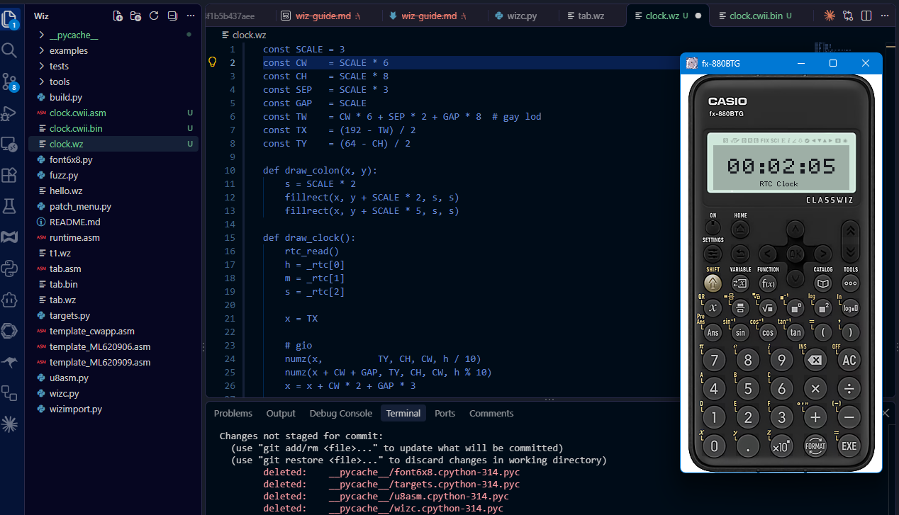

<div align="center">

# Wiz

**A lightweight, Python-inspired compiler for Casio ClassWiz calculators.**

Write `.wz` programs and compile them into calculator-ready ROM binaries.


</div>

---

## 🚀 Features

- 🐍 **Python-inspired syntax** — functions, loops, conditions and expressions.
- ⚙️ **Native compilation** — generates assembly and `.bin` files.
- 🎯 **Multi-target support** — supports multiple ClassWiz hardware targets.
- 🖥️ **Built-in runtime** — graphics, keyboard input, timing and memory access.
- 🔧 **Assembly toolkit** — integrated assembler, runtime and hardware templates.

---
## 📒 Guide

rewriting…

---

## ⚡ Quick Start

**Requirements:** Python 3.10+

```bash
git clone https://github.com/pkdev-en/Wiz.git
cd Wiz
```

Compile a program:

```bash
python3 build.py hello.wz
```

Choose a target:

```bash
python3 build.py hello.wz --target cwii
python3 build.py hello.wz --target cw
python3 build.py hello.wz --target cwapp
```

## 🎯 Supported Targets

| Target | Chip | Display |
|---|---|---|
| `cwii` | ML620909 | 192 × 64 · 4 shades |
| `cw` | ML620906 | 192 × 63 · Monochrome |
| `cwapp` | ML620906 | Firmware-patched application |

## 💡 Example

```python
def main():
    clear()
    for i in range(0, 64):
        pixel(i, i)
```

Save as `hello.wz`, then compile:

```bash
python3 build.py hello.wz
```

## 📁 Project Structure

| File / Folder | Description |
|---|---|
| `docs/` | Guide |
| `examples/` | Example Wiz programs |
| `tests/` | Compiler tests |
| `tools/` | Development utilities |
| `build.py` | Build script |
| `wizc.py` | Wiz compiler |
| `u8asm.py` | Assembler |
| `runtime.asm` | Runtime routines |
| `targets.py` | Hardware target definitions |

## 📷 Screenshot



---

<div align="center">

### 🧪 Built for experimentation

**Wiz** · Casio ClassWiz development toolkit

<sub>Work in progress — hardware compatibility and features may vary by target.</sub>

</div>

